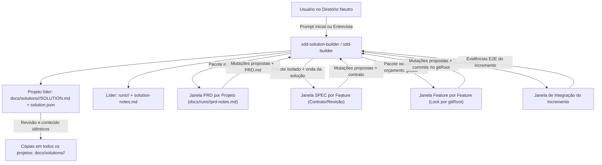

---
todos:
  - id: "solution-entrypoint"
    content: "Criar o agente entry-point sdd-solution-builder (Claude/Cursor e Copilot) e a skill solution-builder atuando em diretório neutro acima dos projetos"
    status: completed
  - id: "solution-contracts"
    content: "Definir projeto líder, schemas em docs/solutions/<solution-id>, replicação dos artefatos da solução em todos os projetos, locks POSIX, cálculo de onda e checkpoints por escopo"
    status: completed
  - id: "orchestrator-routing"
    content: "Estender sdd-builder (Claude/Cursor e Copilot) para descobrir soluções nos projetos do workspace, resolver o líder, rotear para sdd-solution-builder e agendar incrementos"
    status: completed
  - id: "prd-incremental-scope"
    content: "Atualizar prd-builder e sdd-prd-builder para escopo por root do projeto, evolução incremental preservando histórico e checkpoint em prd-notes.md"
    status: completed
  - id: "spec-contract-gates"
    content: "Atualizar spec-builder e sdd-spec-builder para operar por feature em contexto isolado, ler contratos por revisão e retornar mutações propostas de specPath"
    status: completed
  - id: "feature-git-isolation"
    content: "Atualizar feature-builder, work-unit e progress-tracker para pré-flight de links, serialização por gitRoot, delegação adaptativa ao harness e mutações propostas"
    status: completed
  - id: "validation-docs-version"
    content: "Adicionar cenários de validação, atualizar README.md e subir versão para 1.4.0 nos 3 manifests do plugin e nos 4 marketplaces"
    status: completed
isProject: false
---
# Modo enterprise multiprojeto no sdd-builder (Versão AGY)

## Resumo

Adicionar uma camada de solução acima do fluxo existente, preservando um PRD e um roadmap por projeto. A solução atua a partir de um **diretório neutro coordenador** (tipicamente um nível acima dos diretórios e repositórios dos projetos), mantendo requisitos transversais, incrementos, referências a contratos de integração e dependências entre features de diferentes projetos. **O diretório neutro pode não estar versionado em Git; somente os projetos têm versionamento garantido.** Um projeto líder mantém a fonte canônica dos artefatos da solução, replicada em `docs/solutions/<solution-id>/` de todos os projetos participantes. Esse diretório contém exclusivamente artefatos da solução; PRDs, roadmaps, features, SPECs, planos e testes continuam em `docs/` dos respectivos projetos.

O plugin passa a oferecer um **entry-point dedicado (`sdd-solution-builder` / skill `solution-builder`)** para iniciar ou evoluir a especificação e implementação da solução, além do roteamento automático pelo `sdd-builder`. Cada revisão de PRD, SPEC de feature, implementação e validação de integração roda em contexto isolado, com escritor único centralizado e respeito estrito aos limites de delegação e de repositórios Git.



---

## 1. Entry-point da Solução e Diretório Neutro (`sdd-solution-builder`)

### Verificação de existência e lacuna resolvida
No estado atual do plugin (`v1.3.0`), existem apenas quatro agentes de fluxo (`sdd-builder`, `sdd-prd-builder`, `sdd-spec-builder`, `sdd-feature-builder`), todos desenhados para operar **dentro da raiz de um único projeto**. Não existia um entry-point dedicado para iniciar uma solução a partir de uma pasta coordenadora neutra acima dos repositórios.

Esta versão introduz:
1. **Agente entry-point `sdd-solution-builder`** em `sdd-builder/agents/sdd-solution-builder.md` e `sdd-builder/copilot-agents/sdd-solution-builder.agent.md`.
2. **Skill `solution-builder`** em `sdd-builder/skills/solution-builder/SKILL.md`.
3. **Roteamento no `sdd-builder`**: ao receber pedido explícito de solução ou encontrar `docs/solutions/<solution-id>/solution.json` no projeto atual ou nos projetos candidatos do workspace, resolve o projeto líder e delega ou assume o contrato do `solution-builder`. Estar em um diretório neutro inicia a sondagem/entrevista, sem pressupor que essa pasta seja um repositório nem ativar o modo solução silenciosamente.

### Topologia no diretório neutro e persistência nos projetos
O diretório de trabalho da solução fica **um nível acima** dos diretórios e repositórios dos projetos (ou na raiz de um workspace coordenador). Ele é apenas a base de descoberta e resolução dos caminhos: **não exige `.git`, `docs/` nem qualquer artefato persistente próprio**.

```text
<solution-workspace>/                          # Diretório neutro; pode não ter Git
├── api-billing/                               # Projeto líder; Git próprio
│   └── docs/
│       ├── PRD.md                             # PRD exclusivo deste projeto
│       ├── prd_map_progress.json              # Roadmap exclusivo deste projeto
│       ├── F02-invoices/                       # SPEC, plano e testes da feature
│       ├── runs/<run-id>/prd-notes.md          # Checkpoint do PRD deste projeto
│       └── solutions/
│           └── pagamentos/                    # Somente artefatos da solução
│               ├── SOLUTION.md                # Visão e aceite global canônicos
│               ├── solution.json              # Projetos, líder, links e incrementos
│               ├── snapshot.json              # Revisão e hashes dos artefatos replicados
│               ├── solution.lock/             # Lock local transitório; não replicar/versionar
│               └── runs/
│                   ├── solution-notes.md       # Checkpoint da entrevista da solução
│                   └── <run-id>/
│                       ├── state.json         # Estado global persistível
│                       ├── dispatch/<project>/<task-id>.json
│                       └── integration/       # Evidências de integração do incremento
├── web-checkout/                              # Outro projeto; Git próprio
│   └── docs/
│       ├── PRD.md
│       ├── prd_map_progress.json
│       ├── F04-checkout/                       # SPEC, plano e testes locais
│       ├── runs/<run-id>/prd-notes.md
│       └── solutions/pagamentos/              # Cópia dos artefatos da solução do líder
└── shared-contracts/                          # Se participante, também recebe a cópia
    └── docs/solutions/pagamentos/
```

O subdiretório `<solution-id>` permite que um projeto participe de várias soluções sem colisões. No restante do plano, `SOLUTION_DIR` designa `<leader.root>/docs/solutions/<solution-id>/`; caminhos `docs/solutions/<solution-id>/...` são relativos à raiz de cada projeto, nunca ao diretório neutro.

Monorepos também são suportados: `gitRoot` aponta para a mesma raiz Git compartilhada e o agendador serializa etapas mutáveis naquele `gitRoot`. Cada `projects[].root` continua recebendo sua cópia em `docs/solutions/<solution-id>/`.

### Projeto líder, replicação e separação de escopos

- **Eleição do líder**: respeitar o projeto indicado pelo usuário; na ausência de indicação, propor o menor `projects[].id` em ordem lexicográfica entre os projetos com checkout Git validado. Registrar o líder confirmado em `leaderProjectId` antes de persistir os artefatos. A escolha permanece estável nas retomadas; não eleger outro líder silenciosamente se ele estiver indisponível.
- **Fonte canônica**: o orquestrador escreve primeiro no `SOLUTION_DIR` do líder. As demais cópias são réplicas de leitura, publicadas exclusivamente pelo mesmo orquestrador. O manifesto registra `solutionId`, `leaderProjectId`, `solutionArtifactsDir` e `revision`, com conteúdo idêntico em todos os projetos.
- **Escopo replicado**: visão da solução, manifesto, notas da entrevista da solução, estado global, pacotes de despacho e evidências de integração. `snapshot.json` registra a revisão e os hashes desses arquivos; locks, temporários, identificadores de sessão locais e outros dados efêmeros de execução não entram no snapshot nem no Git. O estado persistível registra referências lógicas necessárias ao handoff/retomada.
- **Escopo local**: PRD, roadmap, checkpoints de entrevista de PRD, features, SPECs, planos, testes e contratos definidos nas SPECs permanecem nos `docs/` dos projetos responsáveis. `links` referencia esses contratos por caminho e revisão; não copia os documentos para `docs/solutions/`. Pacotes de despacho referenciam os artefatos locais sem duplicá-los.
- **Publicação**: incrementar `revision` sob o lock do líder; validar o snapshot canônico e publicar a mesma revisão em todos os participantes. Gravar arquivos por temporário + renomeação atômica e publicar `snapshot.json` por último em cada destino. O marcador só identifica uma cópia válida quando todos os hashes conferem. Não existe transação atômica entre repositórios: falhas deixam a sincronização pendente, registrada pelo orquestrador, e impedem novos despachos e conclusão do incremento até reconciliação.
- **Retomada e divergência**: comparar líder e réplicas por `solutionId`, revisão e hashes. Completar cópias interrompidas a partir de um snapshot íntegro do líder; nunca usar a réplica com maior revisão ou timestamp como autoridade automática. Alterações divergentes exigem reconciliação explícita. Sem checkout do líder, é possível inspecionar uma réplica íntegra, mas novas escritas exigem restaurar o líder ou confirmar sua substituição e republicar em todos os participantes.
- **Versionamento**: garantir que os artefatos duráveis estejam em caminhos versionáveis de cada projeto, detectando regras de ignore que impeçam sua inclusão. Qualquer commit desses artefatos ocorre no respectivo `gitRoot`, com escopo exclusivo em `docs/solutions/<solution-id>/` e respeitando os locks Git. Replicação em disco não equivale a commit nem autoriza push. Não criar repositório Git no diretório neutro.

### Comportamento de entrada do `sdd-solution-builder`

Ao ser iniciado no diretório neutro, o `sdd-solution-builder` opera em dois modos conforme a entrada do usuário:

1. **Prompt inicial informado pelo usuário**:
   - O usuário descreve a solução, os projetos que a compõem e seus respectivos `paths` e repositórios Git.
   - O agente valida no disco cada caminho informado (relativo ao diretório neutro ou absoluto), inspeciona a identidade Git (`git rev-parse --show-toplevel`), detecta PRDs/roadmaps ou código preexistente em cada projeto e apresenta o resumo consolidado para confirmação incluindo `solutionId` e projeto líder, antes de gravar `SOLUTION.md` e `solution.json` no `SOLUTION_DIR` e replicá-los em todos os participantes.
2. **Prompt sem detalhes ou invocação direta (Entrevista de Requisitos Mínimos)**:
   - Caso o usuário não informe a descrição da solução, os projetos ou seus caminhos/repositórios, o agente **não adivinha nem ativa modo solução silenciosamente**.
   - Faz uma sondagem não-intrusiva nos subdiretórios de primeiro nível (`./*/.git`, `pnpm-workspace.yaml`, `nx.json`, `go.work`, `*.sln`, `./*/docs/PRD.md`) apenas para listar diretórios candidatos encontrados no workspace.
   - Conduz uma **entrevista estruturada**, uma pergunta por vez, até coletar os **requisitos mínimos obrigatórios** abaixo. Antes de haver projeto líder confirmado, mantém as respostas na sessão e prioriza a definição do catálogo e do líder; assim que possível, persiste as respostas em `SOLUTION_DIR/runs/solution-notes.md` e as replica nos participantes:
     1. **Objetivo e domínio da solução**: qual problema transversal a solução resolve e quais são os critérios de aceite de ponta a ponta.
     2. **Catálogo de projetos**: `id`, nome, papel (`product` ou `platform`), stack principal e se o projeto é novo (greenfield) ou existente; definir também o `solutionId` e o projeto líder.
     3. **Caminhos e repositórios (`root` e `gitRoot`)**: diretório de cada projeto em relação ao diretório neutro e qual repositório Git o governa (sem fazer `git clone`, branch ou push automáticos sem autorização). A ausência de Git no diretório neutro é válida; cada projeto participante precisa ter seu `gitRoot` validado antes da persistência e replicação.
     4. **Fronteiras e contratos iniciais (`links`)**: quem fornece e quem consome APIs, eventos, pacotes ou schemas entre os projetos.
     5. **Escopo do Incremento Inicial (`I01`)**: quais projetos e entregas fazem parte da primeira rodada de especificação e implementação.

---

## 2. Arquitetura, Schemas e Cálculo de Ondas

### Manifesto `<project-root>/docs/solutions/<solution-id>/solution.json`

Combina a rastreabilidade de contratos/incrementos com campos explícitos e determinísticos. O exemplo reside canonicamente em `api-billing/docs/solutions/pagamentos/solution.json` e é copiado sem alterações para os demais projetos:

```json
{
  "solutionId": "pagamentos",
  "solution": "Plataforma de Pagamentos",
  "leaderProjectId": "billing",
  "solutionArtifactsDir": "docs/solutions/pagamentos",
  "revision": 1,
  "version": "1.0",
  "lang": "pt-BR",
  "workspaceRoot": ".",
  "updatedAt": "2026-11-07T20:47:00Z",
  "projects": [
    {
      "id": "billing",
      "name": "Billing Service",
      "kind": "platform",
      "root": "./api-billing",
      "gitRoot": "./api-billing",
      "repoUrl": "git@github.com:org/api-billing.git",
      "prdPath": "./api-billing/docs/PRD.md",
      "roadmapPath": "./api-billing/docs/prd_map_progress.json"
    },
    {
      "id": "checkout",
      "name": "Checkout Web",
      "kind": "product",
      "root": "./web-checkout",
      "gitRoot": "./web-checkout",
      "repoUrl": "git@github.com:org/web-checkout.git",
      "prdPath": "./web-checkout/docs/PRD.md",
      "roadmapPath": "./web-checkout/docs/prd_map_progress.json"
    }
  ],
  "links": [
    {
      "id": "L01",
      "provider": { "project": "billing", "feature": "F02" },
      "consumer": { "project": "checkout", "feature": "F04" },
      "contract": "./api-billing/docs/F02-invoices/spec.md#api-contracts",
      "contractRevision": "sha256:...",
      "kind": "http-api"
    }
  ],
  "increments": [
    {
      "id": "I01",
      "title": "Faturamento e Checkout Inicial",
      "status": "in-progress",
      "projects": ["billing", "checkout"],
      "features": ["billing:F01", "billing:F02", "checkout:F01", "checkout:F04"],
      "integrationCommand": "",
      "acceptanceCriteria": [
        "Checkout cria fatura síncrona no Billing e exibe comprovante"
      ]
    }
  ],
  "notes": ""
}
```

`workspaceRoot: "."` representa a base lógica do workspace, fornecida ou confirmada na sessão; não significa a pasta do manifesto. `root`, `gitRoot`, `prdPath`, `roadmapPath` e `links[].contract` são resolvidos contra essa base, mesmo ao ler uma réplica. `solutionArtifactsDir` é relativo a cada `projects[].root`; o caminho canônico deriva do projeto apontado por `leaderProjectId`. Caminhos absolutos externos continuam permitidos, mas uma mudança de máquina ou de checkout exige remapeamento validado antes de escrever. Pacotes persistidos usam referências lógicas; caminhos absolutos operacionais são resolvidos no despacho. A descoberta a partir de um projeto exige localizar ou confirmar a base do workspace, sem presumir que a pasta pai seja sempre a correta.

### Referências, Ondas da Solução e Grafo de Dependências em 3 Níveis

- **Identificadores**: Referências globais na solução usam `projectId:F01` (ex.: `billing:F02`). Dentro de cada projeto, IDs e pastas locais permanecem `F01`, `docs/F01-*/`, preservando 100% de compatibilidade com os fluxos locais. A seção 8 de cada PRD continua contendo apenas dependências internas daquele projeto.
- **Cálculo automático da Onda da Solução**: Dentro de um incremento, a ordem de liberação combina a onda interna do projeto com os `links` entre projetos:
  $$\text{onda\_solucao}(v) = \max\left(\text{onda\_interna}(v),\; 1 + \max_{u \in \text{deps\_locais}(v)} \text{onda\_solucao}(u),\; 1 + \max_{p \in \text{providers}(v)} \text{onda\_solucao}(p)\right)$$
  Considere `max(conjunto vazio) = 0`. A recorrência propaga atrasos externos aos dependentes locais, evitando liberar uma feature antes de sua dependência interna quando esta foi deslocada por um link entre projetos.
- **Três níveis de portão no grafo**:
  1. **Portão de Contrato (para SPEC)**: A geração da SPEC consumidora (`checkout:F04`) exige que a SPEC fornecedora (`billing:F02`) já tenha sido gerada, validada pelo orquestrador e registrada com `contractRevision`. Foundation features ainda não implementadas no mesmo projeto continuam exigindo execução sequencial prévia.
  2. **Portão de Implementação (para Feature)**: A implementação da feature consumidora exige suas dependências locais (seção 8 do PRD local) implementadas **e** todas as features fornecedoras nos `links` com `status: done` e verificadas.
  3. **Portão de Integração (para o Incremento)**: A conclusão do incremento exige todas as features vinculadas em `done` e os critérios/testes de integração entre projetos aprovados. Ciclos ou contratos incompatíveis bloqueiam imediatamente as tarefas afetadas e exigem revisão do incremento.

---

## 3. Execução, Contextos Isolados, Concorrência e Retomada

### Contextos separados e pacotes de despacho
Cada delegação via `Task` recebe apenas o caminho para o pacote persistido em `SOLUTION_DIR/runs/<run-id>/dispatch/<project>/<task-id>.json`, após publicação e verificação da revisão nas réplicas. A janela filha não herda o histórico completo do orquestrador.
- Um contexto novo é aberto para:
  1. Criação ou revisão incremental de PRD de um projeto (`sdd-prd-builder`).
  2. Geração de SPEC de uma feature (`sdd-spec-builder`).
  3. Implementação de uma feature (`sdd-feature-builder`).
  4. Validação de integração do incremento.
- **Checkpoints de entrevista**:
  - Durante a entrevista inicial da solução, após confirmar o líder: `SOLUTION_DIR/runs/solution-notes.md`, replicado em todos os projetos.
  - Durante a entrevista de PRD de cada projeto: `<project-root>/docs/runs/<run-id>/prd-notes.md`, exclusivamente no projeto correspondente, fora de `docs/solutions/`. Se a janela filha for interrompida, uma nova janela retoma a partir das decisões já confirmadas.
- **Escolha de modelos**: Se a janela filha de feature puder interagir com o usuário, ela apresenta o plano e colhe os modelos conforme `model-selection.md`. Se o host não permitir interação em subagentes, o orquestrador resolve os dois seletores (`implementation-model` e `test-model`), grava no pacote de despacho e dispara a janela.

### Capacidades do Harness e Delegação Aninhada
O orquestrador verifica as capacidades reais do harness antes da Etapa 3:
- **Com delegação aninhada**: a janela do `sdd-feature-builder` coordena normalmente seus workers (`sdd-*-specialist` e `sdd-test-specialist`).
- **Sem delegação aninhada**: o `sdd-feature-builder` planeja as unidades e devolve os pacotes de `work-unit` para o orquestrador principal despachar diretamente os especialistas, respeitando o orçamento global de workers.
- **Sem mecanismo de contexto isolado**: a tarefa fica em estado `blocked` (aguardando handoff externo persistido); execução inline na mesma sessão da solução nunca é disfarçada como contexto isolado.

### Orçamento Global de Workers e Exclusão por `gitRoot`
- Limite global padrão: `max-workers = 3` (compartilhado entre janelas da solução e workers internos de fases).
- **Paralelismo entre repositórios vs. Serialização no mesmo Git**:
  - Projetos com `gitRoot` distintos podem executar etapas mutáveis (implementação e commits) em paralelo.
  - Projetos que compartilham o mesmo `gitRoot` (monorepo) têm suas etapas mutáveis e commits **estritamente serializados** sob lock daquele `gitRoot`, evitando contenção em `.git/index.lock` e commits misturados.
  - Em qualquer commit, o `feature-builder` opera no `gitRoot` do projeto e faz stage exclusivamente dos caminhos pertencentes à unidade/projeto.

### Protocolo Single-Writer e Mutações Propostas
- O `sdd-solution-builder` / `sdd-builder` é o **único escritor** dos artefatos canônicos e das réplicas da solução. Usa `mkdir SOLUTION_DIR/solution.lock`, releitura, escrita em `.tmp` e `mv` atômico, mantendo o lock do líder durante a publicação. O lock é local e transitório: não é replicado nem versionado. Publicações adquirem também o lock de cada `gitRoot` afetado, em ordem determinística; nenhum worker mantém um lock Git enquanto aguarda o lock da solução. Workers de PRD/SPEC/feature não editam `docs/solutions/`, inclusive no projeto líder. A exclusão pressupõe um workspace compartilhado; execuções em clones independentes exigem coordenação externa, sem promover réplicas a escritores concorrentes.
- Para respeitar a regra de `Forbidden writers` do `progress-tracker` (que proíbe subagentes em fan-out paralelo de escreverem diretamente no roadmap), as janelas delegadas em modo solução **retornam mutações propostas de roadmap** (`specPath`, `status`, `note`, `decisions`). O orquestrador da solução valida os artefatos no disco (estrutura do PRD, presença de `spec.md`/`plan.md`/`tests.md`, evidências de testes) e aplica a mutação no `prd_map_progress.json` de cada projeto usando o lock POSIX por projeto (`<project-root>/docs/prd_map_progress.lock`).

### Evolução Incremental de PRD e Invalidação de Contratos
- Ao revisar um PRD existente para um novo incremento, o `prd-builder` preserva IDs, `specPath`, `status: done` e evidências anteriores. Novas features recebem novos IDs sequenciais; remoções são anotadas com `note: "no longer in PRD"` sem apagar histórico; alterações em features já `done` exigem reabertura explícita ou nova feature evolutiva.
- O checkpoint registra o hash/revisão (`contractRevision`) dos documentos e contratos. Se um contrato fornecedor mudar após o despacho de uma SPEC ou feature consumidora ainda não concluída, o orquestrador invalida a tarefa consumidora e bloqueia sua continuação até reconciliação.
- Na retomada de sessão, o orquestrador reconcilia revisão e hashes das cópias da solução, `state.json` do líder, locks ativos, arquivos e commits Git de cada projeto antes de redesenhar a fila; tarefas `running` com writer ativo não são redisparadas cegamente.

---

## 4. Mapeamento Exato de Arquivos do Plugin

### Arquivos novos
- `sdd-builder/skills/solution-builder/SKILL.md`: contrato da camada de solução, descoberta e entrevista no diretório neutro, eleição e persistência do líder, schemas de `SOLUTION.md`, `solution.json`, `snapshot.json` e `state.json`, replicação em `docs/solutions/<solution-id>/` de todos os participantes, cálculo de onda da solução, protocolo de locks, mutações propostas e reconciliação sem depender de Git no workspace.
- `sdd-builder/agents/sdd-solution-builder.md`: agente entry-point para Claude Code e Cursor.
- `sdd-builder/copilot-agents/sdd-solution-builder.agent.md`: agente entry-point equivalente para GitHub Copilot CLI.

### Arquivos existentes a atualizar
- `sdd-builder/agents/sdd-builder.md` e `sdd-builder/copilot-agents/sdd-builder.agent.md`: incluir referência à skill `sdd-builder-plugin:solution-builder`, descoberta de `docs/solutions/<solution-id>/solution.json` no projeto atual ou nos projetos candidatos, resolução do líder e da base do workspace, seleção explícita se houver múltiplas soluções, roteamento para `sdd-solution-builder` e coordenação dos pacotes de despacho.
- `sdd-builder/skills/prd-builder/SKILL.md`, `sdd-builder/agents/sdd-prd-builder.md` e `sdd-builder/copilot-agents/sdd-prd-builder.agent.md`: receber `PROJECT_ROOT`, `PRD_PATH` e `ROADMAP_PATH` do pacote de despacho; restringir varredura de código e `AGENTS.md` ao `root` do projeto; gravar checkpoints em `<project-root>/docs/runs/<run-id>/prd-notes.md`, fora de `docs/solutions/`; suportar atualização incremental preservando features `done`.
- `sdd-builder/skills/spec-builder/SKILL.md`, `sdd-builder/agents/sdd-spec-builder.md` e `sdd-builder/copilot-agents/sdd-spec-builder.agent.md`: operar sobre uma feature por janela quando acionado pela solução (com Auto-Accept se o pacote marcar execução por onda), ler os contratos dos `providers` listados nos `links` e devolver mutação proposta de `specPath` sem tocar no roadmap diretamente.
- `sdd-builder/skills/feature-builder/SKILL.md`, `sdd-builder/agents/sdd-feature-builder.md` e `sdd-builder/copilot-agents/sdd-feature-builder.agent.md`: executar pré-flight da seção 8 local mais verificação de cada `link` (`provider` em `done` e artefato de contrato presente na revisão esperada); rodar suíte na raiz do projeto; commitar no `gitRoot` fazendo stage apenas dos arquivos da unidade; retornar mutação proposta de `status`/`note`/`decisions`.
- `sdd-builder/skills/work-unit/SKILL.md`: fixar raiz absoluta em `projects[].root`; permitir que `read_files` inclua contratos externos autorizados nos `links`, mantendo `write_files` estritamente confinado ao `root` do projeto da unidade e excluindo `docs/solutions/`, reservado ao orquestrador.
- `sdd-builder/skills/progress-tracker/SKILL.md`: documentar a modalidade de aplicação de mutações propostas pelo orquestrador em modo solução, mantendo o schema de `prd_map_progress.json` inalterado.
- `sdd-builder/README.md` e manifests (`sdd-builder/.claude-plugin/plugin.json`, `sdd-builder/.cursor-plugin/plugin.json`, `sdd-builder/plugin.json`, `marketplace.json`, `.claude-plugin/marketplace.json`, `.cursor-plugin/marketplace.json`, `.github/plugin/marketplace.json`): documentar o entry-point `sdd-solution-builder`, o workspace possivelmente sem Git, o líder, a replicação e a separação entre artefatos locais e de solução; atualizar a versão de `1.3.0` para `1.4.0`.

---

## 5. Plano de Entrega e Validação

### Incrementos de implementação do plugin
1. **Incremento 1 — Entry-point e Contratos (`solution-builder`)**: criar `sdd-solution-builder` (Claude/Cursor/Copilot) e `skills/solution-builder/SKILL.md` com entrevista no diretório neutro, schemas versionados (`SOLUTION.md`, `solution.json`, `state.json`, `solution-notes.md`), eleição do líder, schema de `snapshot.json`, replicação exclusivamente dos artefatos da solução, cálculo de onda e protocolo de lock sem depender de versionamento do diretório neutro.
2. **Incremento 2 — Fluxo Documental Multiprojeto (`prd-builder` e `spec-builder`)**: confinamento por `projects[].root`, entrevista com checkpoint em `prd-notes.md`, evolução incremental de PRD e geração de SPEC isolada com leitura/validação de contratos transversais.
3. **Incremento 3 — Scheduler Global e Execução (`sdd-builder`, `feature-builder`, `work-unit`, `progress-tracker`)**: despacho adaptativo conforme capacidade de delegação aninhada do harness, serialização por `gitRoot` incluindo publicação das réplicas, retorno de mutações propostas, retomada com reconciliação das cópias e porta de validação de integração do incremento.
4. **Incremento 4 — Documentação e Distribuição (`v1.4.0`)**: sincronização dos agentes Claude/Cursor e Copilot CLI, atualização do `README.md` e bump para `1.4.0` nos 3 manifests do plugin e nos 4 manifests de marketplace.

### Cenários obrigatórios de verificação
- **Inicialização no diretório neutro**:
  - Com prompt completo (projetos + paths + repositórios) $\rightarrow$ geração direta após confirmação.
  - Sem dados no prompt $\rightarrow$ varredura de candidatos vizinhos + entrevista de requisitos mínimos com checkpoint de solução no líder e nas réplicas após sua confirmação; sem escrita obrigatória no diretório neutro.
- **Workspace sem Git**: inicializar com `.git` somente nos projetos; todos os artefatos duráveis da solução ficam no líder e nas cópias dos participantes, sem exigir `docs/` ou `.git` no diretório neutro. Detectar destino ignorado pelo Git e checkpoint ausente.
- **Eleição e descoberta do líder**: indicação explícita ou proposta determinística confirmada; iniciar pelo diretório neutro, pelo líder e por uma réplica; múltiplas soluções exigem seleção; líder ausente não causa promoção automática.
- **Replicação e recuperação**: conteúdo, revisão e hashes iguais em todos os participantes; interrupção antes/depois da publicação de `snapshot.json`; cópia desatualizada, edição divergente, participante indisponível, remapeamento de caminhos em novo checkout e restauração ou troca explícita do líder. Nenhum despacho ocorre enquanto a publicação estiver incompleta.
- **Separação de artefatos**: apenas artefatos de solução em `docs/solutions/<solution-id>/`; PRDs, roadmaps, features, SPECs, planos, testes, contratos de feature e `prd-notes.md` permanecem nos `docs/` dos respectivos projetos. Réplicas contêm referências a esses documentos, sem cópias deles; locks e temporários nunca são replicados/versionados.
- **Isolamento de escopo e IDs**: projetos distintos com IDs locais iguais (`billing:F01` e `checkout:F01`), caminhos relativos ao diretório neutro, caminhos absolutos externos e detecção de checkout ausente.
- **Fluxo completo com dependência cruzada**: incremento envolvendo `billing` (API) e `checkout` (Frontend): entrevista/atualização de PRD $\rightarrow$ SPEC fornecedora (`billing:F02`) $\rightarrow$ validação de contrato $\rightarrow$ SPEC consumidora (`checkout:F04`) $\rightarrow$ implementação fornecedora $\rightarrow$ implementação consumidora $\rightarrow$ validação de integração do incremento.
- **Segurança contra anomalias**: ciclos em `links`, referências inexistentes, mudança de contrato após despacho (invalidação da tarefa consumidora), interrupção antes/depois do despacho e reconciliação sem redisparo duplicado.
- **Concorrência Git e Harness**: execução paralela entre repositórios distintos, serialização obrigatória quando dois projetos compartilham o mesmo `gitRoot` e fallback correto em harness sem delegação aninhada.
- **Zero regressão no modo single-project**: ausência de solução descoberta e de pedido explícito de modo solução mantém exatamente o comportamento, caminhos e schemas atuais do `sdd-builder`.

---

## 6. Registro da implementação

Implementado no plugin `sdd-builder-plugin` versão **1.4.0**: entry-point multiplataforma,
skill `solution-builder` e referências de contratos/publicação, roteamento, modos de
solução em PRD/SPEC/feature/work-unit/progress-tracker, documentação e sete manifests
sincronizados. Os contratos incluem recuperação de publicação parcial, concessões Git,
orçamento global de contextos, despacho direto sem delegação aninhada e propostas
idempotentes, mantendo os artefatos locais fora de `docs/solutions/`.

Verificação estática: YAML dos agentes/skills, JSON dos manifests/exemplos, paridade dos
agentes, links locais, referências/revisões e resolução de caminhos do pacote, além de
`git diff --check`. Cenários de ensaio e limites estão em
[`sdd-builder/docs/validation-solution.md`](sdd-builder/docs/validation-solution.md).
Os ensaios comportamentais em sessões reais dos três hosts não foram executados.
