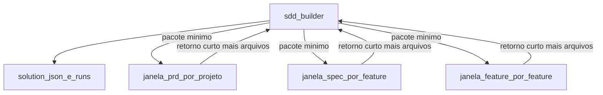

<!-- 57da95bd-2fec-4d8c-9b71-2712f0bbf5be -->
---
todos:
  - id: "solution-tracker"
    content: "Criar a skill solution-tracker com schema, lock, cálculo de onda, diário e pacote de disparo"
    status: pending
  - id: "orchestrator"
    content: "Estender sdd-builder (Claude/Cursor e Copilot) para diagnosticar, portar dependências, disparar janelas e verificar artefatos"
    status: pending
  - id: "prd-scope"
    content: "Restringir prd-builder e sdd-prd-builder ao root do pacote e gravar prd-notes.md"
    status: pending
  - id: "spec-window"
    content: "Fazer a janela de spec de uma feature obedecer ao pacote e deixar specPath para o orquestrador"
    status: pending
  - id: "feature-links"
    content: "Acrescentar pré-flight de links, suíte no projeto e commit no gitRoot no feature-builder e no work-unit"
    status: pending
  - id: "docs-version"
    content: "Atualizar README e versão 1.4.0 nos manifests do plugin e nos quatro marketplaces"
    status: pending
isProject: false
---
# Modo solução multi-project no sdd-builder

O fluxo de um produto permanece o padrão quando `docs/solution.json` não existe. Com esse arquivo, ou quando o usuário pede solução, multi-project ou vários projetos, o `sdd-builder` passa a operar um portfólio: lê cada projeto, calcula o que está liberado e abre uma janela nova por incremento.

## Artefatos novos

Skill nova [sdd-builder/skills/solution-tracker/SKILL.md](sdd-builder/skills/solution-tracker/SKILL.md), no mesmo estilo de contrato do [progress-tracker](sdd-builder/skills/progress-tracker/SKILL.md). O roadmap por projeto não muda de schema.

`docs/solution.json` na raiz do workspace alvo:

- `solution`, `version` `"1.0"`, `lang`, `updatedAt`
- `projects[]`: `id`, `name`, `root`, `gitRoot`, `prdPath`, `roadmapPath`, `kind` (`product` ou `platform`)
- `links[]`: `id` `L01`, `consumer` e `provider` como `{ project, feature }`, `contract`, `kind`
- `notes`

Referência cruzada só na solução: `billing:F03`. Dentro do projeto o ID continua `F01`. Ondas da solução são calculadas na leitura: `max(onda interna, 1 + maior onda dos providers)`. A seção 8 de cada PRD continua só com dependências internas.

Escritor único de `docs/solution.json`: o `sdd-builder`. Lock `docs/solution.lock`, releitura, mutação mínima e `mv` atômico, igual ao protocolo já descrito em [progress-tracker](sdd-builder/skills/progress-tracker/SKILL.md). Subagentes não gravam esse arquivo.

Diário `docs/.sdd/runs.json` e pacote `docs/.sdd/dispatch/<project>/<increment>.json`. O diário guarda incremento, projeto, feature, estado (`queued`, `running`, `verified`, `failed`) e o retorno curto. Uma sessão nova do orquestrador retoma por esses arquivos.

## Orquestrador

Atualizar [sdd-builder/agents/sdd-builder.md](sdd-builder/agents/sdd-builder.md) e a cópia [sdd-builder/copilot-agents/sdd-builder.agent.md](sdd-builder/copilot-agents/sdd-builder.agent.md). Incluir a skill `sdd-builder-plugin:solution-tracker`. Palavras de ativação: solução, multi-project, vários projetos, enterprise.

Diagnóstico:

- Sem `docs/solution.json` e com um PRD: fluxo atual.
- Vários PRDs sem manifesto: oferecer montar a solução. Descoberta por workspaces (`pnpm-workspace.yaml`, `nx.json`, `go.work`, `*.sln`) e por PRDs já existentes. Um `.sln` com vários `.csproj` continua um projeto enquanto houver um único PRD.
- Com manifesto: ler cada roadmap, contar status, listar specs e mostrar o portfólio. Contexto da sessão fica nesse resumo, nos `links` e no último retorno.

Cada delegação via `Task` leva só o caminho do pacote. A filha não herda o transcript. Limite padrão de janelas paralelas: 3, alinhado a `max-workers`.

Portão, recalculado depois de cada retorno:

- PRD: projeto no manifesto sem PRD e roadmap válidos. Uma janela de entrevista por vez.
- Spec: feature `todo` na onda da solução do lote. Providers dos `links` já têm spec. Foundation ainda sem implementação, no mesmo projeto, em janelas sequenciais.
- Feature: `spec.md`, `plan.md` e `tests.md` presentes, dependências da seção 8 implementadas, providers dos `links` com `status: done`.

Verificação no disco, lendo estrutura e descartando o corpo:

- PRD: arquivo existe, H1, nove seções, roadmap JSON, IDs iguais aos da seção 8.
- Spec: três arquivos no `specPath`. O orquestrador grava `specPath` uma vez, com um lock por projeto, depois que as janelas da onda voltam. A filha não altera `status`.
- Feature: a janela de feature é quem muda `status` e `note`. O orquestrador só confirma `done` ou `in-progress` com nota.

Falha de uma janela não cancela as outras. Novo disparo é outra janela, com o pacote anterior e a nota. A sessão da solução não executa etapa 3 inline.

Entrevista de PRD e escolha de modelos ficam na janela filha. Durante o PRD, decisões confirmadas vão para `docs/.sdd/<project>/prd-notes.md` para uma janela nova continuar. Se a janela de feature não puder falar com o usuário, o orquestrador pergunta só os dois modelos, grava no pacote e dispara.

## Skills existentes

[prd-builder](sdd-builder/skills/prd-builder/SKILL.md) e [sdd-prd-builder](sdd-builder/agents/sdd-prd-builder.md) (mais a cópia Copilot): em modo solução, `PROJECT_ROOT`, `PRD_PATH` e `ROADMAP_PATH` vêm do pacote. O scan de código e de `AGENTS.md` fica em `root`. Checkpoint das decisões em `prd-notes.md`.

[spec-builder](sdd-builder/skills/spec-builder/SKILL.md) e o agente da etapa 2: janela disparada pela solução executa uma feature, com Auto-Accept se o pacote marcar onda, e não escreve o roadmap. Lê os contratos dos providers só para contexto. O modo batch atual, dentro de um único PRD, permanece para quem chama o `sdd-spec-builder` direto.

[feature-builder](sdd-builder/skills/feature-builder/SKILL.md): pré-flight interno da seção 8 mais cada `link` com provider `done` e artefato citado presente. Suíte final na raiz do projeto. Comando de integração da solução só se o manifesto declarar `integrationCommand`. Commit no `gitRoot`, stage só dos caminhos da unidade. Workers continuam sem stage, commit ou roadmap.

[work-unit](sdd-builder/skills/work-unit/SKILL.md): raiz absoluta é `projects[].root`. `read_files` pode apontar contrato de outro projeto. `write_files` fica no projeto da unidade.

## Documentação e versão

Atualizar [sdd-builder/README.md](sdd-builder/README.md) com o modo solução, o manifesto, o ciclo do orquestrador e a regra de janela por incremento. Subir a versão do plugin de `1.3.0` para `1.4.0` nos três manifests do plugin e nas quatro cópias de marketplace, com a mesma descrição e keywords acrescentando solução multi-project.

Sem alteração de comportamento quando `docs/solution.json` está ausente.
