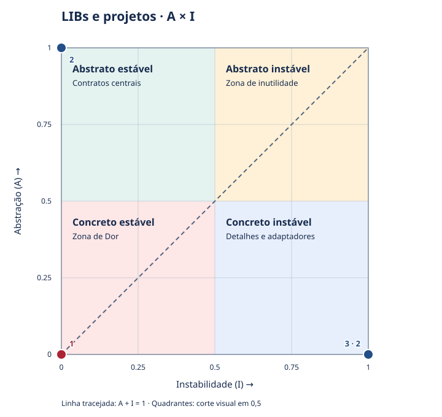
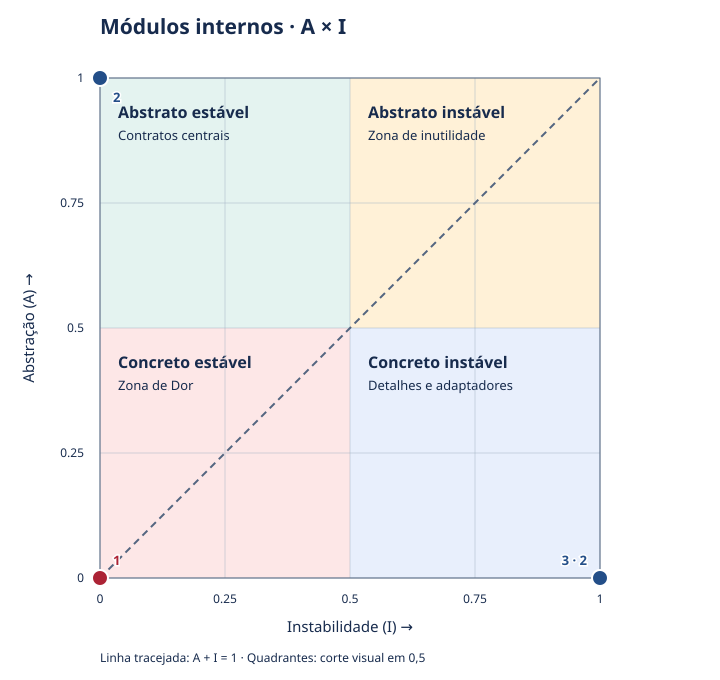

# Análise do acoplamento

> Exemplo gerado de uma solução sintética .NET com Core, Contracts, Api e Worker. Não representa uma solução real.

Relatório gerado por análise estática determinística. Relação `origem → destino` significa que a origem depende do destino.

## Escopo e método

- Linguagens: dotnet.
- CE usado em I: somente interno.
- CA e CE contam vizinhos distintos, não ocorrências, tipos ou dependências transitivas.
- I = CE / (CA + CE); A = tipos abstratos / tipos totais; D = |A + I - 1| (distância normalizada).
- I de componente isolado, A sem tipos e métricas sem código de bibliotecas externas são indeterminados.
- A é uma aproximação sintática específica de cada linguagem; não mede a qualidade dos contratos.
- Os valores refletem o escopo observado. Referências não resolvidas podem subestimar CA/CE.

### Limites configurados

```json
{
  "pain_max_a": 0.2,
  "pain_max_i": 0.2,
  "pain_min_ca": 2,
  "useless_min_a": 0.8,
  "useless_min_i": 0.8
}
```

Os limites das zonas são políticas configuráveis deste plugin, não cortes definidos pelo material de apoio.

## LIBs e projetos

4 componentes internos; 5 relações observadas; 0 ciclos (grupos fortemente conexos).



Eixo X: instabilidade I, calculada por CA/CE. Eixo Y: abstração A, calculada pelos tipos reconhecidos. Linha tracejada: A + I = 1.

Os quatro quadrantes usam corte visual em 0,5: concreto estável (região da Zona de Dor), abstrato estável (contratos centrais), concreto instável (detalhes/adaptadores) e abstrato instável (região da Zona de Inutilidade). Valores iguais a 0,5 pertencem ao lado alto de cada eixo. O quadrante não substitui os limites configurados: pontos vermelhos atendem à Zona de Dor; pontos âmbar atendem à Zona de Inutilidade; os demais são azuis.

O número identifica o ponto na tabela; “número · quantidade” reúne componentes nas mesmas coordenadas, sem deslocá-los. Passe o cursor sobre o ponto no HTML para consultar seus componentes. I ou A indeterminado: sem posição no gráfico. Classes contribuem para A do componente; não há grafo de dependências individuais por classe.

| Ponto | Componente | CA | CE interno | CE externo | I | A | D | Zona de Dor |
| --- | --- | ---: | ---: | ---: | ---: | ---: | ---: | --- |
| [3](coupling-libraries.svg#chart-libraries-point-3) | dotnet:library:Api/Api.csproj | 0 | 2 | 1 | 1.0000 | 0.0000 | 0.0000 | não |
| [2](coupling-libraries.svg#chart-libraries-point-2) | dotnet:library:Contracts/Contracts.csproj | 2 | 0 | 0 | 0.0000 | 1.0000 | 0.0000 | não |
| [1](coupling-libraries.svg#chart-libraries-point-1) | dotnet:library:Core/Core.csproj | 2 | 0 | 0 | 0.0000 | 0.0000 | 1.0000 | sim |
| [3](coupling-libraries.svg#chart-libraries-point-3) | dotnet:library:Worker/Worker.csproj | 0 | 2 | 0 | 1.0000 | 0.0000 | 0.0000 | não |

### Diagnóstico e prioridades

- **Zona de Dor: dotnet:library:Core/Core.csproj**. CA=2, I=0.0000, A=0.0000. Avaliar contratos e pontos de variação antes de alterar este componente; revisar seus consumidores.
- **Impacto de mudança: dotnet:library:Contracts/Contracts.csproj** tem 2 consumidores diretos. CA alto indica criticidade; sozinho não comprova defeito.
- **Impacto de mudança: dotnet:library:Core/Core.csproj** tem 2 consumidores diretos. CA alto indica criticidade; sozinho não comprova defeito.
- **Exposição: dotnet:library:Api/Api.csproj** depende de 2 componentes internos. Revisar responsabilidades e volatilidade dos destinos; CE alto sozinho não comprova fragilidade.
- **Exposição: dotnet:library:Worker/Worker.csproj** depende de 2 componentes internos. Revisar responsabilidades e volatilidade dos destinos; CE alto sozinho não comprova fragilidade.

### Ciclos

- Nenhum ciclo observado.

### Dependências contrárias à estabilidade

- Nenhuma relação com I(origem) < I(destino) observada.

### Relações e evidências

- dotnet:library:Api/Api.csproj → dotnet:external:package:newtonsoft.json
  - `Api/Api.csproj:1`: declared:package:newtonsoft.json.
- dotnet:library:Api/Api.csproj → dotnet:library:Contracts/Contracts.csproj
  - `Api/Api.cs:2`: import:Example.Contracts.
  - `Api/Api.csproj:1`: declared:project_path:Contracts/Contracts.csproj.
- dotnet:library:Api/Api.csproj → dotnet:library:Core/Core.csproj
  - `Api/Api.cs:1`: import:Example.Core.
  - `Api/Api.csproj:1`: declared:project_path:Core/Core.csproj.
- dotnet:library:Worker/Worker.csproj → dotnet:library:Contracts/Contracts.csproj
  - `Worker/Worker.cs:2`: import:Example.Contracts.
  - `Worker/Worker.csproj:1`: declared:project_path:Contracts/Contracts.csproj.
- dotnet:library:Worker/Worker.csproj → dotnet:library:Core/Core.csproj
  - `Worker/Worker.cs:1`: import:Example.Core.
  - `Worker/Worker.csproj:1`: declared:project_path:Core/Core.csproj.

### Dependências externas observadas

- dotnet:external:package:newtonsoft.json: 1 consumidor interno observado; I/A/D/Zona de Dor indeterminados sem código externo.

## Módulos internos

4 componentes internos; 4 relações observadas; 0 ciclos (grupos fortemente conexos).



Eixo X: instabilidade I, calculada por CA/CE. Eixo Y: abstração A, calculada pelos tipos reconhecidos. Linha tracejada: A + I = 1.

Os quatro quadrantes usam corte visual em 0,5: concreto estável (região da Zona de Dor), abstrato estável (contratos centrais), concreto instável (detalhes/adaptadores) e abstrato instável (região da Zona de Inutilidade). Valores iguais a 0,5 pertencem ao lado alto de cada eixo. O quadrante não substitui os limites configurados: pontos vermelhos atendem à Zona de Dor; pontos âmbar atendem à Zona de Inutilidade; os demais são azuis.

O número identifica o ponto na tabela; “número · quantidade” reúne componentes nas mesmas coordenadas, sem deslocá-los. Passe o cursor sobre o ponto no HTML para consultar seus componentes. I ou A indeterminado: sem posição no gráfico. Classes contribuem para A do componente; não há grafo de dependências individuais por classe.

| Ponto | Componente | CA | CE interno | CE externo | I | A | D | Zona de Dor |
| --- | --- | ---: | ---: | ---: | ---: | ---: | ---: | --- |
| [3](coupling-modules.svg#chart-modules-point-3) | dotnet:module:Api/Api.csproj:Example.Api | 0 | 2 | 0 | 1.0000 | 0.0000 | 0.0000 | não |
| [2](coupling-modules.svg#chart-modules-point-2) | dotnet:module:Contracts/Contracts.csproj:Example.Contracts | 2 | 0 | 0 | 0.0000 | 1.0000 | 0.0000 | não |
| [1](coupling-modules.svg#chart-modules-point-1) | dotnet:module:Core/Core.csproj:Example.Core | 2 | 0 | 0 | 0.0000 | 0.0000 | 1.0000 | sim |
| [3](coupling-modules.svg#chart-modules-point-3) | dotnet:module:Worker/Worker.csproj:Example.Worker | 0 | 2 | 0 | 1.0000 | 0.0000 | 0.0000 | não |

### Diagnóstico e prioridades

- **Zona de Dor: dotnet:module:Core/Core.csproj:Example.Core**. CA=2, I=0.0000, A=0.0000. Avaliar contratos e pontos de variação antes de alterar este componente; revisar seus consumidores.
- **Impacto de mudança: dotnet:module:Contracts/Contracts.csproj:Example.Contracts** tem 2 consumidores diretos. CA alto indica criticidade; sozinho não comprova defeito.
- **Impacto de mudança: dotnet:module:Core/Core.csproj:Example.Core** tem 2 consumidores diretos. CA alto indica criticidade; sozinho não comprova defeito.
- **Exposição: dotnet:module:Api/Api.csproj:Example.Api** depende de 2 componentes internos. Revisar responsabilidades e volatilidade dos destinos; CE alto sozinho não comprova fragilidade.
- **Exposição: dotnet:module:Worker/Worker.csproj:Example.Worker** depende de 2 componentes internos. Revisar responsabilidades e volatilidade dos destinos; CE alto sozinho não comprova fragilidade.

### Ciclos

- Nenhum ciclo observado.

### Dependências contrárias à estabilidade

- Nenhuma relação com I(origem) < I(destino) observada.

### Relações e evidências

- dotnet:module:Api/Api.csproj:Example.Api → dotnet:module:Contracts/Contracts.csproj:Example.Contracts
  - `Api/Api.cs:2`: import:Example.Contracts.
- dotnet:module:Api/Api.csproj:Example.Api → dotnet:module:Core/Core.csproj:Example.Core
  - `Api/Api.cs:1`: import:Example.Core.
- dotnet:module:Worker/Worker.csproj:Example.Worker → dotnet:module:Contracts/Contracts.csproj:Example.Contracts
  - `Worker/Worker.cs:2`: import:Example.Contracts.
- dotnet:module:Worker/Worker.csproj:Example.Worker → dotnet:module:Core/Core.csproj:Example.Core
  - `Worker/Worker.cs:1`: import:Example.Core.

### Dependências externas observadas

- Nenhuma dependência externa observada.


## Cobertura e limitações

- dotnet: coletor C# lexical de using e csproj; nomes totalmente qualificados, binding de símbolos, arquivos linked, VB/F# e avaliação MSBuild não cobertos

## Referências metodológicas

- Architectural_Coupling_Science.pdf: material de apoio fornecido, especialmente páginas 3 a 11. Não redistribuído pelo plugin.
- [Robert C. Martin: Design Principles and Design Patterns](https://objectmentor.com/resources/articles/Principles_and_Patterns.pdf).
- Consulte `docs/methodology.md` do plugin para regras por linguagem e limites do reconhecimento estático.
